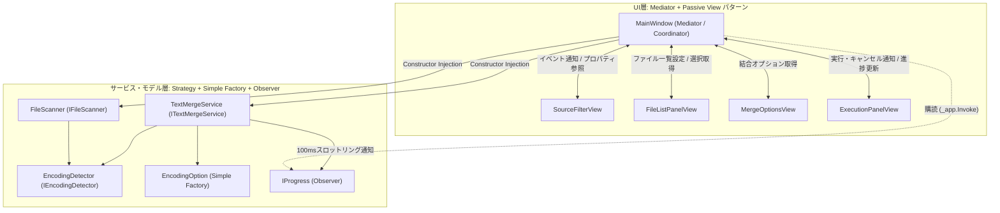
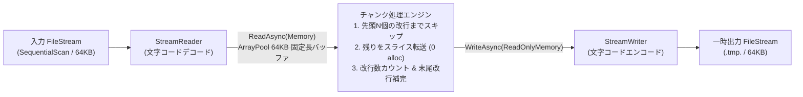
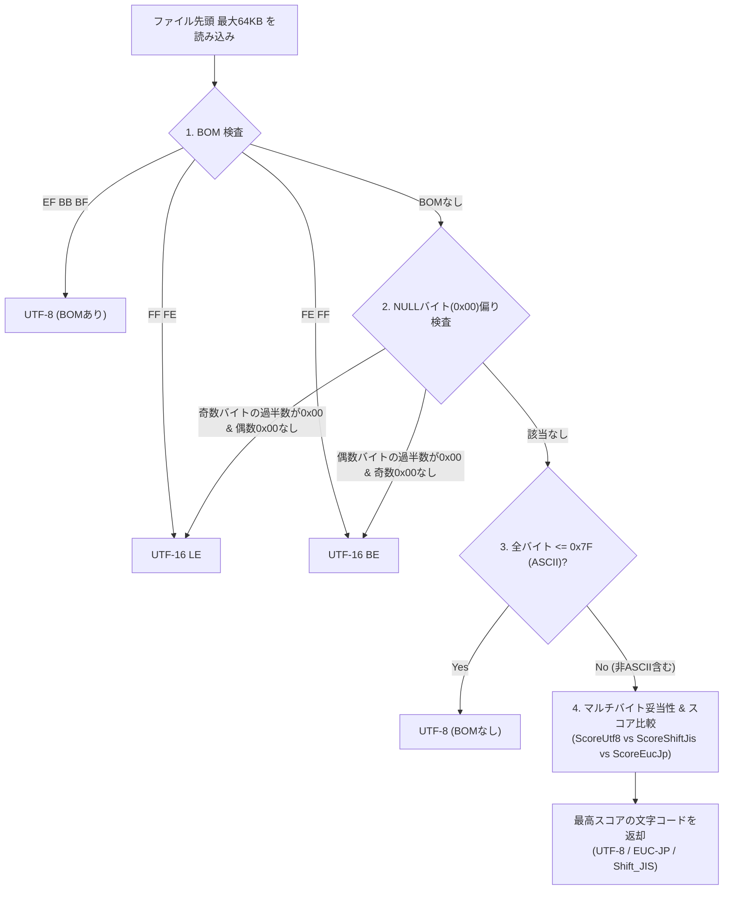

# TextMerger アーキテクチャ・内部設計書

本書では、`TextMerger` の内部構造、採用しているデザインパターン、および大容量ファイル処理・文字コード自動判別のアルゴリズムについて解説します。

---

## 1. ディレクトリ構成とレイヤー責務

プロジェクトは責務ごとに以下の3レイヤー（`UI` / `Services` / `Models`）に分かれており、依存の向きは **`UI` → `Services` → `Models` の単方向** に保たれています。また、すべての公開型は C# 標準規約に従い **「1ファイル1公開型（1 File = 1 Public Type）」** で配置されています。

```text
TextMerger/
├── Program.cs                          # エントリーポイント (TUI起動 / --cli モード分岐)
├── Models/                             # ドメインモデル・設定・進捗・結果レコード
│   ├── EncodingType.cs                 # 文字コード種別列挙型
│   ├── EncodingOption.cs               # 表示名および Encoding インスタンス生成 Factory
│   ├── FileItem.cs                     # ファイル情報・選択状態・サイズフォーマット
│   ├── FileScanResult.cs               # スキャン結果（一致ファイル＋警告一覧）
│   ├── MergeOptions.cs                 # 結合処理オプション設定
│   ├── MergeProgress.cs                # 非同期進捗レポート用レコード
│   └── MergeResult.cs                  # 結合完了結果レコード
├── Services/                           # ビジネスロジック・I/O処理層（UI非依存）
│   ├── IEncodingDetector.cs            # 文字コード判別インターフェース
│   ├── EncodingDetector.cs             # バイト列解析による文字コード自動判別実装
│   ├── IFileScanner.cs                 # ファイル検索インターフェース
│   ├── FileScanner.cs                  # ワイルドカード・サブフォルダ検索実装
│   ├── ITextMergeService.cs            # ファイル結合インターフェース
│   └── TextMergeService.cs             # ArrayPool 固定長チャンク結合実装
└── UI/                                 # Terminal.Gui v2 プレゼンテーション層
    ├── MainWindow.cs                   # 各パネルとサービスを仲介する Coordinator (Mediator)
    ├── UiThemeService.cs               # テーマ一覧構築・切替・丸角枠線スタイル適用
    └── Views/                          # 画面を構成する4つの独立パネル (Passive View)
        ├── SourceFilterView.cs         # 1. 対象フォルダ・検索条件・UIテーマ選択
        ├── FileListPanelView.cs        # 2. ファイル一覧・個別選択・順序入れ替え
        ├── MergeOptionsView.cs         # 3. ヘッダ行数・入出力文字コード設定
        └── ExecutionPanelView.cs       # 4. 出力先指定・進捗バー・結合実行/キャンセル
```

---

## 2. 採用デザインパターンと選定理由

小〜中規模の TUI / CLI ユーティリティとして、過剰な抽象化（オーバーエンジニアリング）を避けつつ保守性と単体テスト容易性を高めるため、以下のパターンを採用しています。



### 2.1 Mediator + Passive View パターン（UI層）
- 4つのサブパネル（`SourceFilterView`, `FileListPanelView`, `MergeOptionsView`, `ExecutionPanelView`）はお互いの存在を一切知らず、自身の UI コントロール構築とイベント発火・プロパティ公開のみを行います（**Passive View**）。
- `MainWindow` が **Mediator（仲介者）** として各パネルのイベントを受け取り、`IFileScanner` や `ITextMergeService` を呼び出して結果をパネルへ反映します。
- `Terminal.Gui` v2 のイベント駆動モデルと親和性が高く、重量級な MVVM フレームワークを導入せずに各パネルを100〜200行程度の見通しの良いサイズに保っています。

### 2.2 デフォルト引数付き Constructor Injection（軽量 DI）
- `MainWindow`, `FileScanner`, `TextMergeService` はコンストラクタで `IFileScanner? fileScanner = null` のようにインターフェースを受け取り、省略時はデフォルト実装を使用します。
- DI コンテナの初期化コストやボイラープレートを増やさずに、単体テスト時にはモック（例: `CountingEncodingDetector`）を差し込んでI/O回数や振る舞いを検証できます。

### 2.3 スキャン済み文字コードの引き継ぎによる二重 I/O 回避
- `FileScanner` がファイル一覧を走査した時点で判別した `FileItem.DetectedEncoding` を保持し、`TextMergeService.MergeFilesAsync(IReadOnlyList<FileItem>, ...)` にそのまま渡すことで、結合実行時に再度ファイル先頭を読み込んで文字コード判別を行う二重 I/O を排除しています。

---

## 3. 大容量ファイル（1GB超）向け定数メモリ結合アルゴリズム

1GB〜数十GBの巨大ファイルや、改行コードを含まない長大な1行データ（巨大 JSON / XML 等）を結合してもメモリ枯渇（`OutOfMemoryException`）や GC 頻発を起こさないよう、`TextMergeService` は **`ReadLineAsync()`（行ごとの `string` 生成）を使用しない固定長チャンク・ストリーミング方式** を採用しています。



### 3.1 `ArrayPool<char>.Shared` によるゼロアロケーション転送
- `ArrayPool<char>.Shared.Rent(65536)` で **64 KB の `char[]` バッファを1つだけ借り受け**、全ファイルの結合完了まで再利用します（`finally` ブロックで確実に `Return`）。
- ヘッダ行を読み飛ばした後のデータ本体は、`rentedBuffer.AsMemory(offset, bodyLength)` のスライスをそのまま `StreamWriter.WriteAsync` に渡すため、**ループ内での `string` ヒープアロケーションは 0 バイト** です。

### 3.2 チャンク境界（64KB境界）を跨ぐ `\r\n` (CRLF) の状態管理
- 64KB チャンクの最後の1文字が `\r` であり、次のチャンクの最初の1文字が `\n` であった場合、これらを別々の2つの改行として誤認しないよう、`pendingCarriageReturn` フラグでチャンク間の状態を追跡しています。
  - ヘッダスキップ中にチャンク末尾の `\r` でスキップ完了した場合、次チャンク先頭の `\n` が本文の先頭に混入しないよう自動的に消費します。

### 3.3 アトミックな出力ファイル保存（破損防止）
- 出力先ファイルパスへ直接書き込むのではなく、同一ディレクトリ内に `{OutputFilePath}.tmp.{Guid}` という一時ファイルを作成して結合を行います。
- 全ファイルの書き込みとフラッシュが正常に完了した時点で `File.Move(tempOutputPath, fullOutputPath, overwrite: true)` を実行するため、途中でキャンセルやディスクフル等の例外が発生しても、既存の出力先ファイルが中途半端に破損することはありません。

---

## 4. 文字コード自動判別アルゴリズム (`EncodingDetector`)

`EncodingDetector` はファイルの先頭最大 **64 KB (`65536` バイト)** のみを読み込み、以下の4段階の優先順位で文字コードを判別します。



- **サンプル末尾のマルチバイト途切れ耐性**:
  - 64KB を超えるファイルを先頭 64KB で切り出した際、ちょうど 65,536 バイト目でマルチバイト文字（2〜4バイト文字）が途切れていても不正シーケンス（`-1`）と判定しないよう、バッファ末尾の未完シーケンスを許容する設計になっています。
